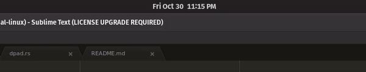

# surface-dial-linux

A Linux userspace controller for the [Microsoft Surface Dial](https://www.microsoft.com/en-us/p/surface-dial/925r551sktgn). Requires Linux Kernel 4.19 or higher.

As you might have guessed by the lack of recent commits, this project has entered **maintenence mode**. While I will not be implementing any new features myself, I am more than glad to take a look at any bug reports and/or review any PRs sent my way! 

## Overview

`surface-dial-daemon` receives raw events from the surface dial and translates them to more conventional input events.

Those events are delivered through whichever path reaches the session you are actually using:

-   **Volume and media actions** go through KDE Plasma's global shortcuts (over D-Bus) when available, which also shows Plasma's volume OSD. Otherwise, fake media keys are sent.
-   **Keys and scrolling** go through the X server's XTEST extension when `$DISPLAY` is set. This also works in remote X sessions (e.g: xrdp, VNC), which never see `uinput` devices.
-   Otherwise (e.g: no X server), a virtual keyboard/mouse is created through `/dev/uinput`. Set `SURFACE_DIAL_BACKEND=uinput` to force this path.

The daemon uses FreeDesktop notifications to provide visual feedback when switching between actions.



It would be cool to create some sort of GUI overlay (similar to the Windows one), though that's out of scope at the moment.

### Operating Modes

Holding down the button for \~750ms will open up a meta-menu (using FreeDesktop notifications) which allows you to switch between operating modes on-the-fly. The daemon persists the last selected mode on-disk, so if you only care about one mode (e.g: scrolling), you can just set it and forget it.

Modes in **bold** should be considered **EXPERIMENTAL**. They seem to work alright (some of the time), but they would really benefit from some more polish / bug fixes.

| Mode                         | Click             | Rotate               | Notes                                                                                  |
| ---------------------------- | ----------------- | -------------------- | -------------------------------------------------------------------------------------- |
| Scroll                       | -                 | Scroll               | Fakes chunky mouse-wheel scrolling <sup>1</sup>                                        |
| **Scroll (Fake Multitouch)** | Reset Touch Event | Scroll               | Fakes smooth two-finger scrolling <sup>2</sup>                                         |
| Zoom                         | -                 | Zoom                 |                                                                                        |
| Volume                       | Mute              | Volume               |                                                                                        |
| Media                        | Play/Pause        | Next/Prev Track      |                                                                                        |
| Media + Volume               | Play/Pause        | Volume               | Double-click = Next Track                                                              |
| **Paddle Controller**        | Space             | Left/Right Arrow Key | Play [arkanoid](https://www.google.com/search?q=arkanoid+paddle) as the devs intended! |

<sup>1</sup> At the time of writing, almost all Linux userspace programs don't take advantage of the newer high-resolution scroll wheel events, and only support the older, chunkier scroll wheel events. Check out [this blog post](https://who-t.blogspot.com/2020/04/high-resolution-wheel-scrolling-in.html) for more details.

<sup>2</sup> Only offered when input goes through `uinput`: a virtual touchpad cannot be faked through XTEST, so the mode is hidden from the meta-menu in that case.

The last selected mode is stored by name in `~/.config/surface-dial-daemon/config.txt`. If that mode is not available (e.g: the multitouch mode under XTEST), the daemon falls back to the first mode.

### Custom Modes

At the moment, all modes (along with their meta-menu ordering) are hard-coded into the daemon itself.

If you don't mind hacking together a bit of [very simple] Rust code, adding new modes should be fairly straightforward - just add a new `ControlMode` implementation under `src/controller/controls` and instantiate it in `main.rs`.

If you ended up implementing new mode you think others would find useful, please consider upstreaming it!

## Building

Building `surface-dial-daemon` requires the following:

-   Linux Kernel 4.19 or higher
-   Rust 1.85 or newer (the version shipped by Debian 13 works)
-   `libudev` (headers) and `pkg-config`

Everything else (evdev, uinput, hidraw, X11, D-Bus) is handled by pure-Rust crates, so no `libevdev`, `hidapi` or `libdbus` package is needed.

```bash
# e.g: on Debian / Ubuntu
sudo apt install cargo rustc pkg-config libudev-dev
```

Once those are installed, `surface-dial-daemon` can be built using the standard `cargo build` flow.

```bash
cargo build --release
```

The resulting binary is output to `target/release/surface-dial-daemon`

If your Rust toolchain is older than the newest dependency versions require, let cargo pick compatible versions when (re)generating `Cargo.lock`:

```bash
CARGO_RESOLVER_INCOMPATIBLE_RUST_VERSIONS=fallback cargo update
```

## Running

The daemon is able to handle the dial disconnecting/reconnecting, so as long as it's running in the background, things should Just Work:tm:.

Note that the daemon must run as a _user process_ (**not** as root), as it needs access to the user's D-Bus and X display.

Running as a user process means the daemon needs access to a few restricted-by-default devices under `/dev/`:

-   the dial's `/dev/input/eventXX` nodes (rotation + button),
-   the dial's `/dev/hidrawX` node (haptic feedback; optional, the dial works without it),
-   `/dev/uinput`, only when input goes through `uinput` (see [Overview](#overview)).

The included udev rule grants exactly those, instead of adding your user to the `input` group (which would also expose every keyboard on the system). See the Installation section below.

During development, the easiest way to run `surface-dial-linux` is using `cargo`:

```bash
cargo run
```

Alternatively, you can run the daemon directly using the executable at `target/release/surface-dial-daemon`.

## Installation

I encourage you to tweak the following setup procedure for your particular Linux configuration.

The following steps have been tested working on Debian 13 (kernel 7.2, KDE Plasma 6 on X11, both locally and over xrdp).

```bash
# Install the `surface-dial-daemon` (i.e: build it, and place it under ~/.cargo/bin/surface-dial-daemon)
# You could also just copy the executable from /target/release/surface-dial-daemon to wherever you like.
cargo install --path . --locked

# the udev rule gives the dial's devices to the `plugdev` group: make sure you are in it
# (log out and back in afterwards if you had to add yourself)
id -nG | grep -qw plugdev || sudo gpasswd -a $(whoami) plugdev

# install the udev rule
sudo cp ./install/70-surface-dial.rules /etc/udev/rules.d/70-surface-dial.rules
sudo udevadm control --reload

# load the uinput module now and at every boot
sudo cp ./install/uinput.conf /etc/modules-load.d/uinput.conf
sudo modprobe uinput

# install, enable and start the systemd user service
mkdir -p ~/.config/systemd/user/
cp ./install/surface-dial.service ~/.config/systemd/user/surface-dial.service
systemctl --user daemon-reload
systemctl --user enable --now surface-dial.service
```

The udev rule only applies to devices created after it was installed: turn the dial (to wake it up) once it has gone to sleep, or re-pair it.

To see if the service is running correctly, run `systemctl --user status surface-dial.service`, and `journalctl --user -u surface-dial.service -f` to follow its log.

Some notes:

-   The rule uses `GROUP="plugdev"` rather than `TAG+="uaccess"` for the dial: `uaccess` grants access to the session owning the local seat, which is the login screen when you are connected remotely (e.g: xrdp). Mixing both is not an option either, as the resulting ACL masks the group permissions on `hidraw` nodes.
-   If your distro has no `plugdev` group, edit the rule to use a group you belong to.
-   The service is tied to `graphical-session.target`, so it needs a desktop session that activates it (KDE Plasma and GNOME do). It is restarted automatically if it fails.
-   You may also need to change DisableSecurity to DisableSecurity=true in /etc/bluetooth/network.conf to successfully pair the Surface Dial.

If things aren't working, feel free to file a bug report!

_Call for Contributors:_ It would be awesome to have a proper packaging pipeline set up as well (e.g for deb/rpm).

## Implementation Notes

Core functionality is provided by the following libraries.

-   `evdev` to find the dial (rescanning every second while it is disconnected), read its events through `/dev/input/eventXX`, and to fake input through `/dev/uinput`.
-   `hidapi` (`linux-native` backend) to configure dial sensitivity + haptics.
-   `x11rb` to fake input through the XTEST extension.
-   `zbus` to trigger KDE global shortcuts, and `notify-rust` to send desktop notifications over D-Bus.

When the dial wakes up, it replays every rotation made while it was asleep. Rotations received within 750ms of connecting are dropped, so a wake-up turn does not send the volume to 0% or 100%.

The code makes heavy use of threads + channels to do non-blocking event handling. While async/await would have been a great fit for an application like this, I optimized for getting something up-and-running rather than maximum performance. Plus, the Rust wrappers around evdev and `hidapi` used here are blocking, so it would have been a lot more work for not too much gain.

The codebase is reasonably well organized, aside from the `dial_device` implementation, which is admittedly a bit gnarly. There's a bit of of thread/channel spaghetti going on to ensure that the lifetime of the haptics object lines up with the lifetime of the evdev device. All things considered, it's not _too_ messy, but it could certainly use some cleanup. Fortunately, if you're only interested in implementing new operating modes, you won't have to worry about any of that, as all the nitty-gritty device interaction is neatly encapsulated behind the `ControlMode` trait.

## Feature Roadmap

This is a rough outline of features I'd like to see implemented in this daemon. There's a non-zero chance that at some point the daemon will be "good enough" for me, and some features will be left unimplemented.

Contributions are more than welcome!

-   [x] Interpreting raw Surface Dial events
-   [x] Haptic Feedback
    -   https://docs.microsoft.com/en-us/windows-hardware/design/component-guidelines/radial-controller-protocol-implementation
    -   https://www.usb.org/sites/default/files/hutrr63b_-_haptics_page_redline_0.pdf
    -   https://www.usb.org/sites/default/files/hut1_21.pdf
    -   _This was tricky to figure out, but in the end, it was surprisingly straightforward! Big thanks to [Geo](https://www.linkedin.com/in/geo-palakunnel-57718245/) for pointing me in the right direction!_
-   [x] Set up a framework to easily implement various operating modes
    -   [x] In-code abstraction over Surface Dial Events / Haptics API
    -   [ ] Config file(s) to create simple custom modes
-   [x] Dynamically switching between operating modes
    -   [x] Using a long-press activated "meta-mode"
    -   [ ] Context-sensitive (based on the currently open application)
-   [ ] Config-file support
    -   [ ] Adjusting timings (e.g: long press timeout, double-click window, etc...)
    -   [ ] Custom operating mode ordering in the meta-menu
-   [x] Visual Feedback
    -   [x] FreeDesktop Notifications
    -   [ ] \(longshot\) Windows-like Wheel menu
-   [x] Last selected mode persistence (between daemon invocations)
-   [x] Gracefully handling disconnect/reconnect
-   [ ] Packaging pipeline (e.g: deb/rpm)
